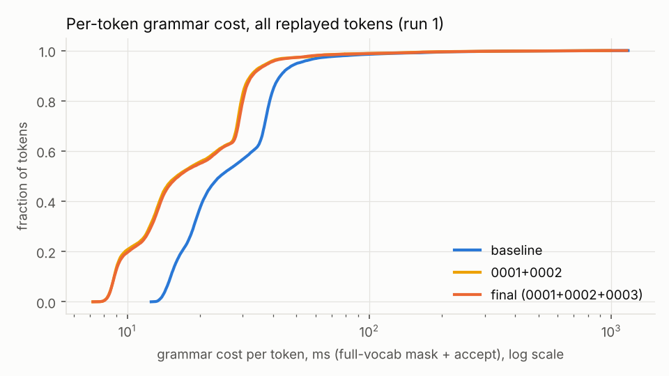
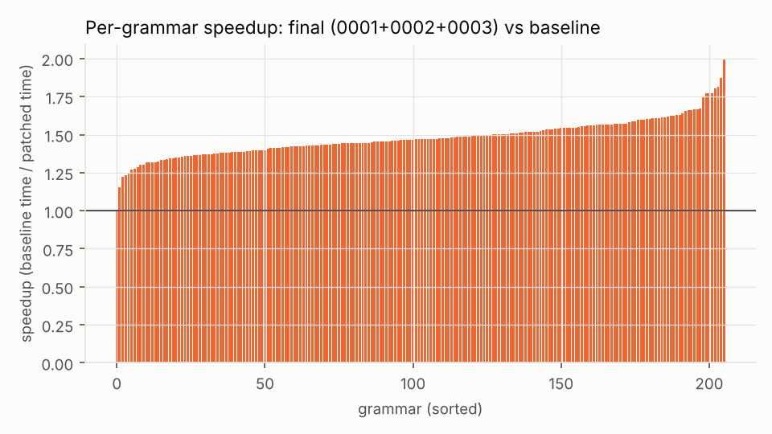

# grammar-tax

**How expensive is grammar-constrained (GBNF) sampling in llama.cpp on a CPU, and how much of that cost can
three small, provably-correct patches remove?**

At every generation step, llama.cpp's grammar sampler has to decide, for every token in the vocabulary
(151,936 for Qwen2.5), whether the token would break the grammar. On this machine that full-vocab
**mask** costs a median of ~27 ms per token, about as much as running the 0.5B model itself, and up to ~1.4 s
per token at positions where hundreds of grammar stacks are alive (JSON objects with many optional
properties).

This repo is a reproducible study of that cost: a record/replay benchmark that isolates the mask from model
inference, profiles, three small patches stored as patch files (llama.cpp itself is never modified in this
repo), a correctness argument backed by bit-exact checks, and an honest account of what did not work.

## Verify it yourself in ~20 minutes

On a 4-core x86-64 Linux or WSL2 machine (CMake, a C++17 compiler, Python 3; ~2 GB disk):

```sh
git clone --recurse-submodules https://github.com/stredevirad/grammar-tax && cd grammar-tax
python3 -m venv build/venv && build/venv/bin/pip install -r scripts/requirements.txt
scripts/fetch_models.sh            # ~1.1 GB of GGUFs, not counted in the time below
scripts/quick_verify.sh
```

[`scripts/quick_verify.sh`](scripts/quick_verify.sh):

1. builds upstream at the pinned SHA and the final series (0001-0003), `grammar_replay` only;
2. checks that the masks are **bit-identical on every step of every recorded trace**: 23,448 Qwen + 21,202
   TinyLlama steps;
3. runs a **3-run interleaved A/B** on 20 grammars ([`data/quick_subset.txt`](data/quick_subset.txt): one from
   each of 19 equal-count bins of the baseline cost distribution, plus o46322, the 600-stack worst case);
4. prints the per-grammar geomean speedup with a bootstrap 95% CI, median, p99 and total.

It exits nonzero if any mask differs. Last run (2026-10-26) on a laptop, Intel Core Ultra 5 125H under WSL2
(Debian 12, GCC 12.2), no ccache: **17 min 29 s** in total (builds 2.2 min, mask check 9.4 min, A/B 5.9 min),
masks bit-identical, **1.590x [1.556, 1.626]**, 20 of 20 grammars faster. The 5-run A/B below gives 1.488x for
the same 20 grammars. All three quick_verify runs so far (two Xeon VMs with an earlier subset, and this laptop)
came out 7-9% above `ab-final` for their subset, so read the printed ratio as "the speedup reproduces", not as a
sharper number than the table below ([results/quick-verify/](results/quick-verify/)). On Python 3.11 (e.g. Debian
12) the pinned numpy 2.5.4 does not install (it needs Python >= 3.12); numpy 2.4.6 with the other pins works.

## Results

Final series (`patches/0001`-`0003`) vs upstream at the pinned SHA, Qwen2.5 vocab (151,936 tokens),
206 grammars (8 built-in + 198 JSONSchemaBench schemas), 23,448 replayed tokens, **5 interleaved runs, paired
per grammar, 95% bootstrap CIs**:

| | baseline | final | change |
|---|---|---|---|
| per-grammar speedup of the mask (geomean) | | | **1.470x** [1.455, 1.486] |
| median per-token mask cost | 27.3 ms [25.4 .. 28.8] | 18.5 ms [18.1 .. 19.0] | **-32.7%** [-34.0, -31.2] |
| p99 per-token mask cost (all tokens pooled) | 159 ms [140 .. 168] | 127 ms [123 .. 142] | **-17.9%** [-24.5, -14.8] |
| grammars faster | | | **206 of 206** (1.03x .. 1.89x) |
| end to end, default sampling path (real model, 28 grammars) | 34.89 tok/s | 35.42 tok/s | **+1.5%** |
| end to end, full mask every step (`grammar_first`) | 15.73 tok/s | 19.54 tok/s | **+24.2%** |
| masks vs upstream | | | **bit-identical** on every one of 44,650 trace steps (2 vocabs) + 17,167 random-walk steps |

**Read the headline correctly:** 1.47x is for **mask computation**. llama.cpp's default sampler only builds
the full mask when the token it sampled is rejected (~5% of steps here), so on the default path (`llama-server`,
`llama-completion`) the end-to-end throughput gain is **about 2%**. Paths that build the mask every step
(`grammar_first = true`, the `llama-speculative` example, a grammar sampler inside a `llama_sampler` chain) see
roughly the full gain: [results/who_benefits.md](results/who_benefits.md) lists them with file:line.





## The patches

| patch | idea | lines |
|---|---|---|
| [0001](patches/0001-grammar-flat-decode-buffer.patch) | decode every vocab piece into **one buffer per call** instead of one heap vector per token (removes ~152k malloc/free pairs per step; transient memory 11.6 MB -> 4.5 MB) | +34 / -14 |
| [0002](patches/0002-grammar-ascii-match-table.patch) | for long candidate lists, **tabulate the char-class match for the 128 ASCII code points** once per stack | +12 / -2 |
| [0003](patches/0003-grammar-reuse-reject-lists.patch) | **reuse two reject lists across stacks** instead of allocating ~4.8 MB per stack; fixes a cold-start page-fault regression that 0001 exposed | +26 / -7 |

All three touch only `src/llama-grammar.cpp`, keep the public API and the output order of
`llama_grammar_reject_candidates_for_stack`, and pass the four llama.cpp grammar tests. Line-by-line
explanations: [LEARNING.md](LEARNING.md). Rejected ideas (with numbers): [results/experiments.md](results/experiments.md).

## What is in this repo

| | |
|---|---|
| [results/REPORT.md](results/REPORT.md) | the full report: method, correctness, every result including failures, threats to validity |
| [results/baseline.md](results/baseline.md), [results/profile.md](results/profile.md) | Phase 1-2: workload, baseline costs, profiles, the GATE |
| [results/experiments.md](results/experiments.md) | every idea tried, kept or rejected, with numbers |
| [results/who_benefits.md](results/who_benefits.md) | which llama.cpp code paths build the full mask, with file:line |
| [LEARNING.md](LEARNING.md) | how the grammar engine works, each patch explained, 15 interview questions |
| [UPSTREAM.md](UPSTREAM.md) | checklist if you want to submit upstream yourself (no PR text is drafted) |
| [RESUME.md](RESUME.md) | resume bullets with the real numbers |
| [DECISIONS.md](DECISIONS.md), [PHASE_LOG.md](PHASE_LOG.md) | every decision and the progress log |
| `bench/` | `grammar_record` (record a constrained generation), `grammar_replay` (vocab-only replay, timings, mask hashes), `grammar_fuzz` (differential random walks + scripted edge cases), `llg_replay` (llguidance reference), `schema_to_gbnf` |
| `scripts/` | workload prep, A/B runner (`run_bench.sh`), paired statistics (`ab_stats.py`), charts (`analyze.py`), mask check, fuzz, profiling, end-to-end runs |
| `patches/` | the series (`0001`-`0003`), `rejected/`, and `third_party/` (upstream PR #28371 diffs used as a comparison arm) |
| `data/`, `bench/traces/` | sampled schemas, converted grammars, prompts, recorded traces |

## Pinned upstream

| | |
|---|---|
| Submodule | `third_party/llama.cpp` (never modified in a committed state) |
| Upstream | https://github.com/ggml-org/llama.cpp |
| Pinned SHA | `620d2225cc436ab0b001e3200e590e3b286ef9ab` (master, 2026-10-15, "llama.cpp : bump version to 0.7.0 (#30603)") |

## Reproduce

Needs Linux x86-64, CMake >= 3.15, a C++17 compiler, Python 3, ~2 GB free disk; ccache and valgrind optional.

```sh
git clone --recurse-submodules https://github.com/stredevirad/grammar-tax && cd grammar-tax
python3 -m venv build/venv && build/venv/bin/pip install -r scripts/requirements.txt
scripts/fetch_models.sh                                   # Qwen2.5-0.5B-Instruct and TinyLlama GGUFs (not in git)

scripts/build_variant.sh third_party/llama.cpp build/bench-base     # upstream at the pinned SHA
scripts/apply_patches.sh build/src-final                            # copy of the pin + patches 0001-0003
scripts/build_variant.sh build/src-final build/bench-final

scripts/run_tests.sh build/bench-final                              # llama.cpp grammar tests
scripts/check_masks.sh build/bench-base build/bench-final           # bit-exact masks on all traces
scripts/run_bench.sh -n 5 -l mine build/bench-base build/bench-final
build/venv/bin/python -I scripts/ab_stats.py results/raw/mine --a base --b final
```

A full 5-run A/B takes ~2 hours on 4 vCPUs. Traces and converted grammars are committed; to regenerate them:
`scripts/fetch_jsb.sh && build/venv/bin/python -I scripts/prepare_workload.py && scripts/record_traces.sh
models/qwen2.5-0.5b-instruct-q4_k_m.gguf qwen05`. Numbers depend on the machine; this study ran on a 4-vCPU
Intel Xeon VM (AVX-512), GCC 13.3, glibc malloc.

## Third-party data and models

- **llama.cpp** (MIT, (c) The ggml authors): git submodule, unmodified; patches in `patches/` are derived from it.
- **JSONSchemaBench** (MIT, EPFL DLAB and guidance-ai; Hugging Face dataset `epfl-dlab/JSONSchemaBench`,
  revision `5bd0f46`; https://github.com/guidance-ai/jsonschemabench): 198 test-split schemas are redistributed
  under `data/schemas/` (200 sampled, 2 duplicate ids dropped) with the converted grammars in `data/grammars/`. From "Generating Structured Outputs from
  Language Models: Benchmark and Studies" (Geng et al., 2025).
- **Models used, not redistributed** (downloaded by `scripts/fetch_models.sh`, ignored by git):
  Qwen2.5-0.5B-Instruct, GGUF Q4_K_M from `Qwen/Qwen2.5-0.5B-Instruct-GGUF` (Apache-2.0);
  TinyLlama-1.1B-Chat-v1.0, GGUF Q4_K_M from `TheBloke/TinyLlama-1.1B-Chat-v1.0-GGUF` (Apache-2.0).
  Recorded token traces in `bench/traces/` are outputs of these models.
- **llguidance** (MIT, guidance-ai): built only as an optional reference point via llama.cpp's
  `-DLLAMA_LLGUIDANCE=ON`; not redistributed.

## Status and conduct

Nothing in this repo has been submitted upstream. llama.cpp forbids automated PRs and AI-written PR text;
[UPSTREAM.md](UPSTREAM.md) is a checklist for a human who decides to submit. The code was written with an AI
assistant (Claude), which must be disclosed in any upstream submission.

License: [MIT](LICENSE).
