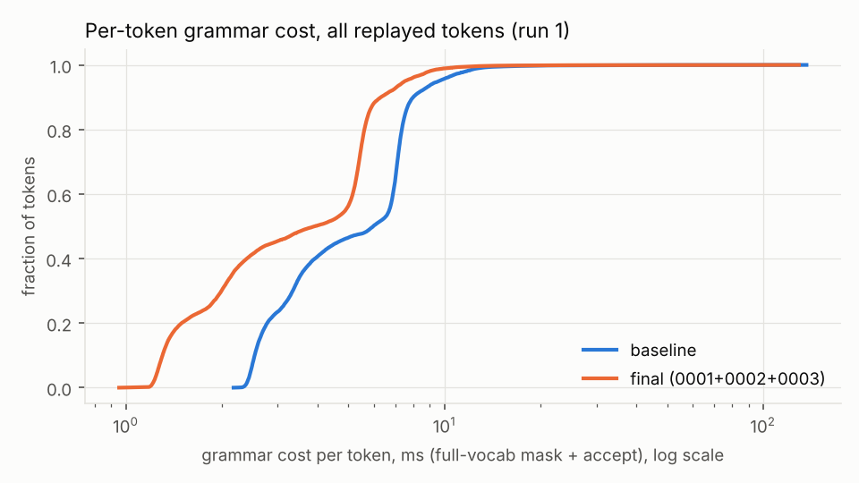
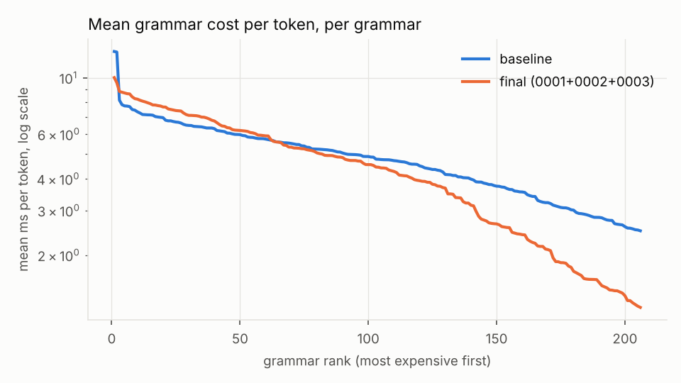
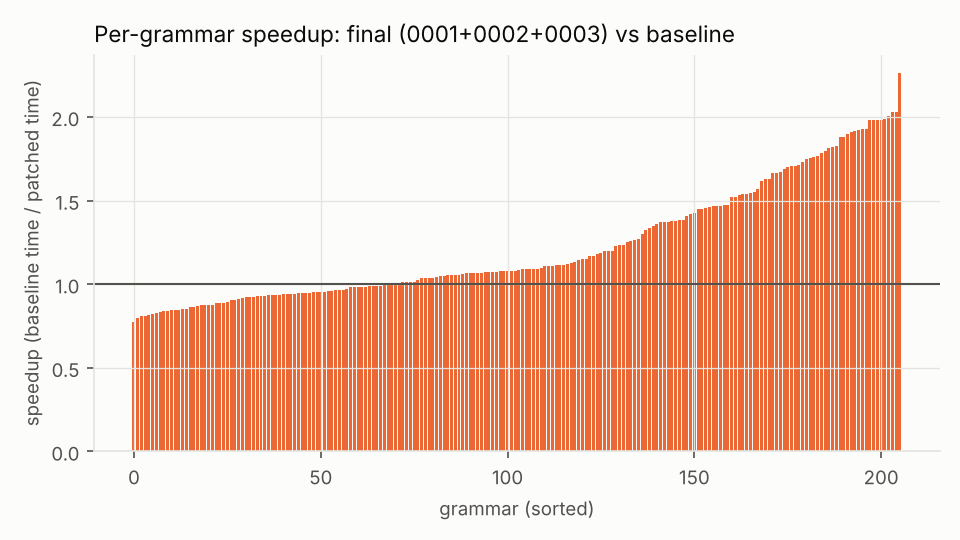
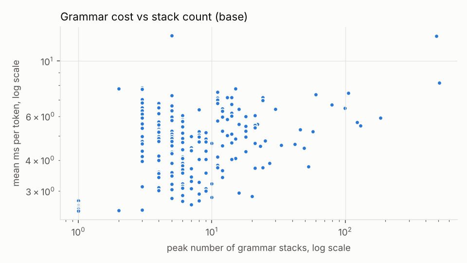

# Benchmark summary: `ab-final-tinyllama`

```
date=2026-10-16T18:59:15+00:00 host=vm kernel=6.18.44-fc-v139 nproc=4 runs=3 jobs=1 model=tinyllama filter=
model name	: Intel(R) Xeon(R) Processor @ 2.80GHz
build build/bench-base: 620d2225cc436ab0b001e3200e590e3b286ef9ab 
build build/bench-reuse: 620d2225cc436ab0b001e3200e590e3b286ef9ab  1 file changed, 73 insertions(+), 22 deletions(-)
MASKS IDENTICAL: base vs reuse (21202 steps)
```

Values: median over runs [min .. max over runs]. Times in microseconds per token (mask + accept) unless noted.

| build | runs | grammars | tokens | median of per-grammar mean | mean over all tokens | pooled p50 | pooled p99 | total replay (s) |
|---|---|---|---|---|---|---|---|---|
| base | 3 | 206 | 21202 | 4815.2 [4746.7 .. 4849.3] | 5526.8 [5436.4 .. 5578.9] | 5977.8 [5905.0 .. 6044.1] | 12530.2 [12383.6 .. 12836.6] | 117.18 [115.26 .. 118.28] |
| reuse | 3 | 206 | 21202 | 4528.9 [3309.2 .. 4669.9] | 5337.4 [3953.8 .. 5409.6] | 3857.8 [3820.1 .. 3912.3] | 12730.5 [10217.0 .. 12904.8] | 113.16 [83.83 .. 114.69] |

## Per subset (base)

| subset | grammars | median per-grammar mean (us) | median per-grammar p99 (us) | max peak stacks |
|---|---|---|---|---|
| Github_easy | 20 | 4987 | 9099 | 12 |
| Github_hard | 20 | 4657 | 9404 | 33 |
| Github_medium | 20 | 4726 | 9596 | 24 |
| Github_trivial | 20 | 3512 | 5573 | 16 |
| Github_ultra | 20 | 4960 | 10442 | 480 |
| Glaiveai2K | 20 | 3443 | 7156 | 12 |
| JsonSchemaStore | 18 | 5087 | 8267 | 505 |
| Kubernetes | 20 | 5388 | 9029 | 23 |
| Snowplow | 20 | 4875 | 8537 | 79 |
| WashingtonPost | 20 | 5485 | 8026 | 60 |
| gbnf | 8 | 5506 | 11060 | 12 |

## Worst 10 grammars by mean per-token cost (base)

| grammar | tokens | mean (us) | p50 (us) | p99 (us) | max (us) | peak stacks |
|---|---|---|---|---|---|---|
| gbnf__english | 256 | 12694 | 12226 | 19930 | 21753 | 5 |
| jsb__Github_ultra__o46322 | 82 | 12629 | 4205 | 134763 | 142120 | 480 |
| jsb__JsonSchemaStore__mason-registry | 256 | 8162 | 6897 | 88535 | 118529 | 505 |
| jsb__WashingtonPost__wp_7_Normalized | 256 | 7831 | 7231 | 12052 | 13743 | 3 |
| jsb__JsonSchemaStore__zapp-schema-1 | 256 | 7747 | 7421 | 11359 | 17537 | 15 |
| gbnf__list | 256 | 7733 | 7326 | 12496 | 14174 | 2 |
| jsb__WashingtonPost__wp_70_Normalized | 256 | 7697 | 7325 | 11255 | 11473 | 3 |
| jsb__WashingtonPost__wp_36_Normalized | 37 | 7494 | 7148 | 10671 | 11451 | 11 |
| jsb__JsonSchemaStore__project-1 | 47 | 7454 | 7499 | 27711 | 28285 | 105 |
| jsb__WashingtonPost__wp_5_Normalized | 256 | 7342 | 7240 | 11324 | 13703 | 60 |

Median grammar by mean per-token cost: `jsb__Github_easy__o8403`

## A/B ratios (other / base, run i vs run i; < 1 is faster)

| build | median of per-grammar mean | mean over all tokens | pooled p99 | total |
|---|---|---|---|---|
| reuse | 0.941 [0.682 .. 0.984] | 0.966 [0.709 .. 0.995] | 1.016 [0.796 .. 1.042] | 0.966 [0.709 .. 0.995] |

## Charts





