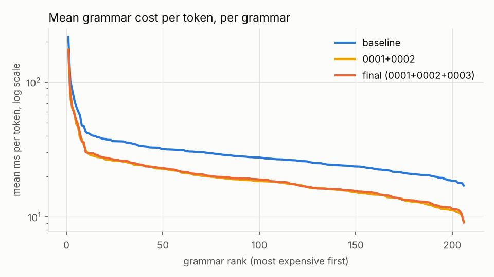
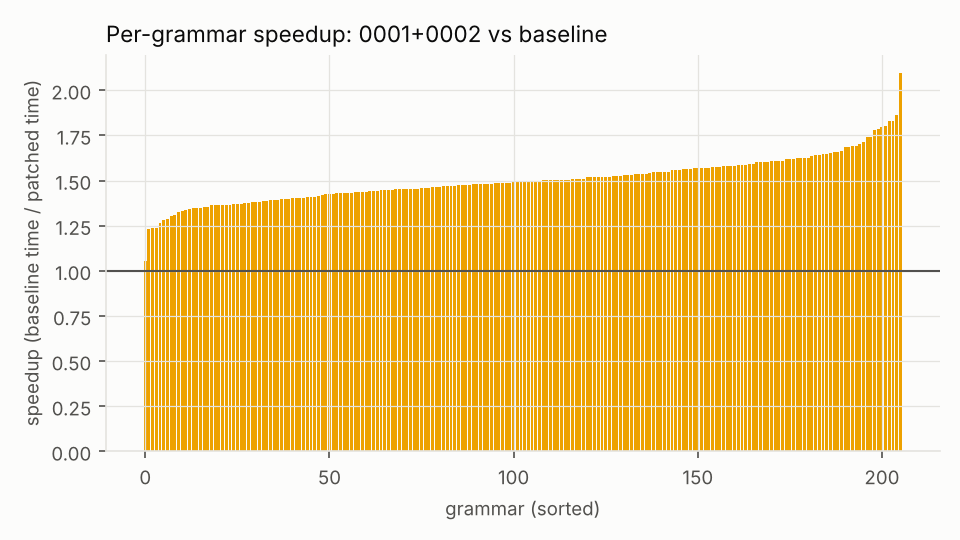
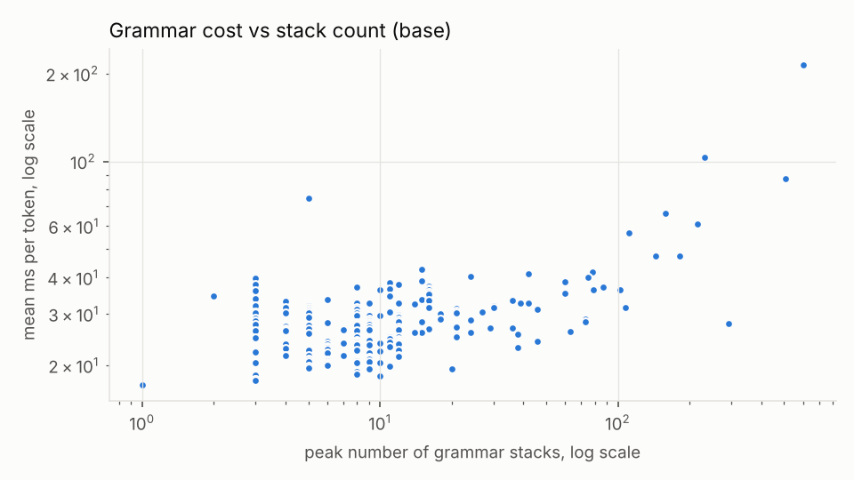

# Benchmark summary: `ab-final`

```
date=2026-10-16T15:46:23+00:00 host=vm kernel=6.18.44-fc-v139 nproc=4 runs=5 jobs=1 model=qwen05 filter=
model name	: Intel(R) Xeon(R) Processor @ 2.80GHz
build build/bench-base: 620d2225cc436ab0b001e3200e590e3b286ef9ab 
build build/bench-p1ascii: 620d2225cc436ab0b001e3200e590e3b286ef9ab  1 file changed, 46 insertions(+), 16 deletions(-)
build build/bench-reuse: 620d2225cc436ab0b001e3200e590e3b286ef9ab  1 file changed, 73 insertions(+), 22 deletions(-)
MASKS IDENTICAL: base vs p1ascii (23448 steps)
MASKS IDENTICAL: base vs reuse (23448 steps)
```

Values: median over runs [min .. max over runs]. Times in microseconds per token (mask + accept) unless noted.

| build | runs | grammars | tokens | median of per-grammar mean | mean over all tokens | pooled p50 | pooled p99 | total replay (s) |
|---|---|---|---|---|---|---|---|---|
| base | 5 | 206 | 23448 | 27284.3 [25421.3 .. 28780.8] | 32932.3 [31720.8 .. 34694.8] | 24254.8 [23906.8 .. 26298.8] | 159323.0 [140064.0 .. 167797.1] | 772.20 [743.79 .. 813.52] |
| p1ascii | 5 | 206 | 23448 | 18347.4 [17926.1 .. 18648.2] | 23146.7 [22802.7 .. 23940.5] | 16007.1 [15662.1 .. 16646.9] | 120508.1 [115535.7 .. 130495.8] | 542.74 [534.68 .. 561.36] |
| reuse | 5 | 206 | 23448 | 18525.6 [18131.3 .. 19027.3] | 23545.2 [23154.9 .. 24688.7] | 16287.3 [15929.4 .. 17372.1] | 126626.6 [123461.8 .. 141879.9] | 552.09 [542.94 .. 578.90] |

## Per subset (base)

| subset | grammars | median per-grammar mean (us) | median per-grammar p99 (us) | max peak stacks |
|---|---|---|---|---|
| Github_easy | 20 | 26925 | 47903 | 73 |
| Github_hard | 20 | 24627 | 54837 | 216 |
| Github_medium | 20 | 27672 | 54641 | 73 |
| Github_trivial | 20 | 28620 | 46375 | 30 |
| Github_ultra | 20 | 30866 | 61464 | 600 |
| Glaiveai2K | 20 | 22276 | 44944 | 12 |
| JsonSchemaStore | 18 | 30889 | 58617 | 505 |
| Kubernetes | 20 | 26390 | 45737 | 18 |
| Snowplow | 20 | 28045 | 54230 | 159 |
| WashingtonPost | 20 | 30339 | 49650 | 144 |
| gbnf | 8 | 32481 | 51655 | 12 |

## Worst 10 grammars by mean per-token cost (base)

| grammar | tokens | mean (us) | p50 (us) | p99 (us) | max (us) | peak stacks |
|---|---|---|---|---|---|---|
| jsb__Github_ultra__o46322 | 215 | 214765 | 24566 | 1174803 | 1211003 | 600 |
| jsb__JsonSchemaStore__rustfmt | 184 | 103387 | 23543 | 501928 | 515613 | 231 |
| jsb__JsonSchemaStore__mason-registry | 162 | 87109 | 29043 | 676859 | 763452 | 505 |
| gbnf__english | 113 | 74937 | 73666 | 113398 | 117088 | 5 |
| jsb__Snowplow__sp_408_Normalized | 254 | 66336 | 23970 | 317675 | 366677 | 159 |
| jsb__Github_hard__o6347 | 126 | 60833 | 35740 | 404289 | 479377 | 216 |
| jsb__JsonSchemaStore__project-1 | 256 | 56788 | 41556 | 242819 | 277830 | 111 |
| jsb__Github_ultra__o17072 | 89 | 47566 | 24514 | 340159 | 366875 | 182 |
| jsb__WashingtonPost__wp_17_Normalized | 256 | 47261 | 38509 | 268680 | 307772 | 144 |
| jsb__Snowplow__sp_392_Normalized | 248 | 42707 | 42261 | 67953 | 75311 | 15 |

Median grammar by mean per-token cost: `jsb__WashingtonPost__wp_30_Normalized`

## A/B ratios (other / base, run i vs run i; < 1 is faster)

| build | median of per-grammar mean | mean over all tokens | pooled p99 | total |
|---|---|---|---|---|
| p1ascii | 0.676 [0.647 .. 0.722] | 0.696 [0.690 .. 0.727] | 0.772 [0.707 .. 0.860] | 0.696 [0.690 .. 0.727] |
| reuse | 0.673 [0.661 .. 0.730] | 0.712 [0.679 .. 0.742] | 0.821 [0.756 .. 0.890] | 0.712 [0.679 .. 0.742] |

## Charts






