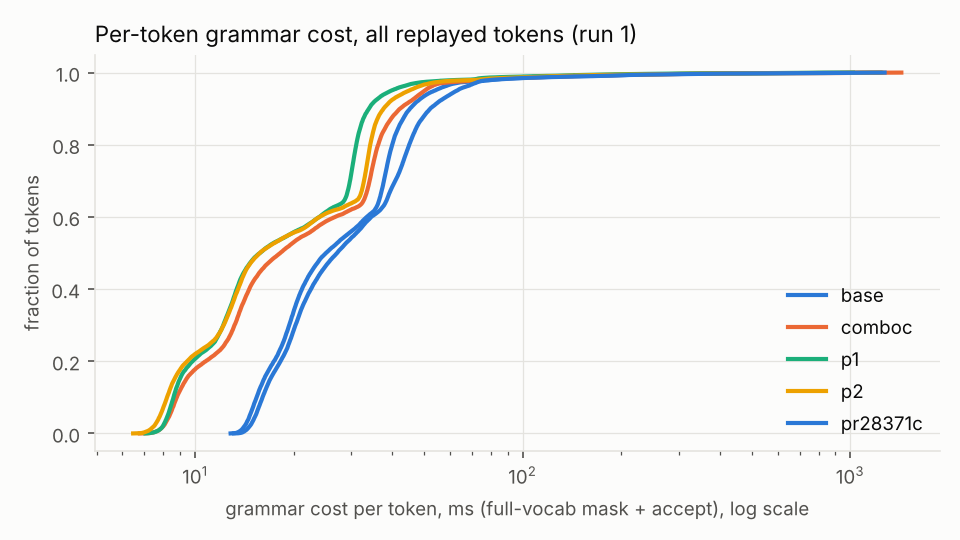
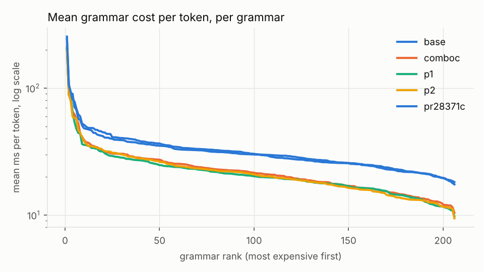
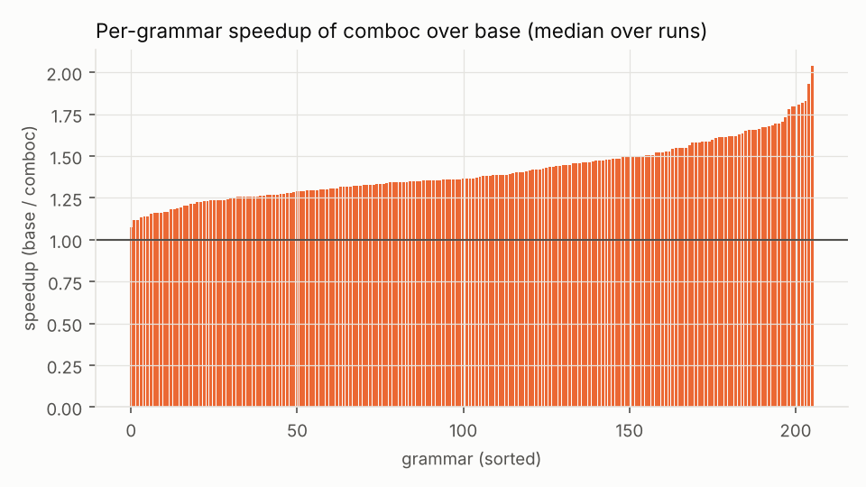
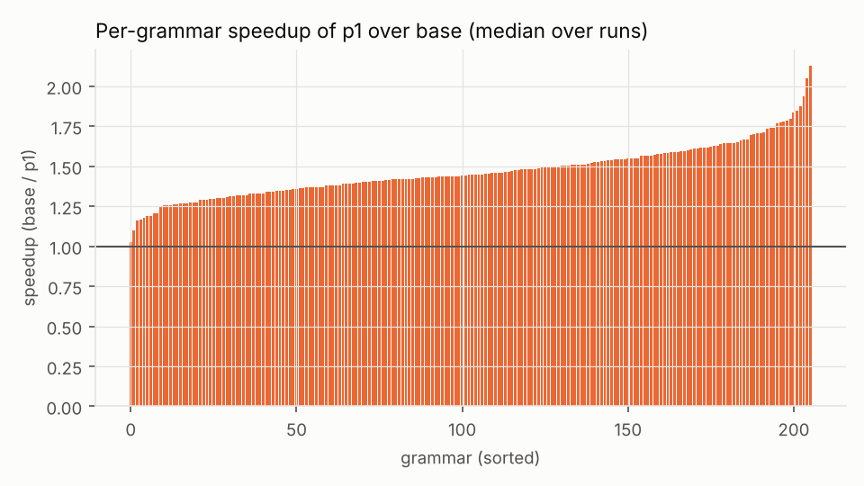
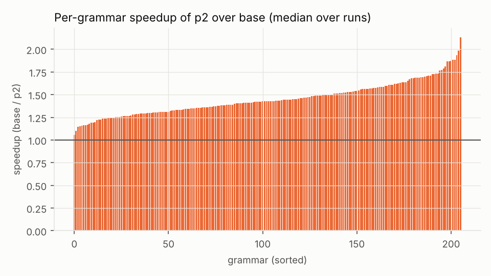
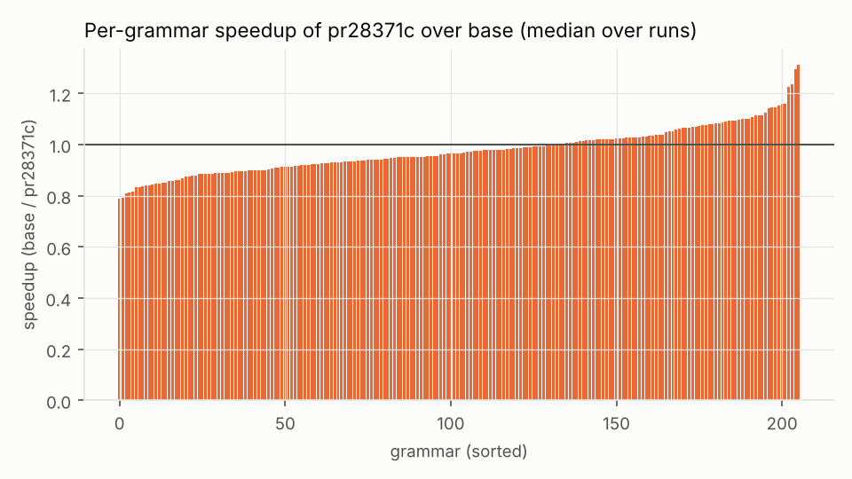
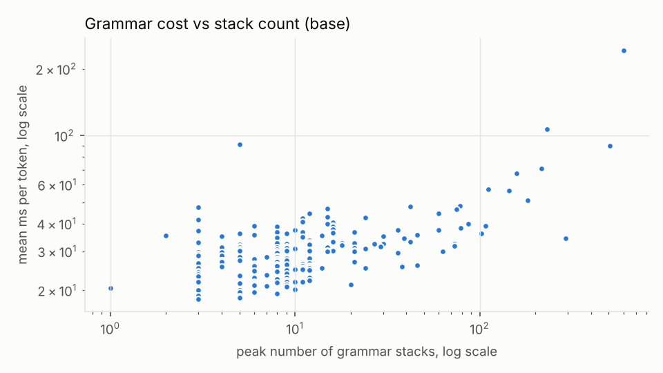

# Benchmark summary: `ab-main`

```
date=2026-10-16T06:08:53+00:00 host=vm nproc=4 runs=3 jobs=1 model=qwen05 filter=
model name	: Intel(R) Xeon(R) Processor @ 2.80GHz
build build/bench-base: 620d2225cc436ab0b001e3200e590e3b286ef9ab 
build build/bench-p1: 620d2225cc436ab0b001e3200e590e3b286ef9ab  1 file changed, 34 insertions(+), 14 deletions(-)
build build/bench-p2: 620d2225cc436ab0b001e3200e590e3b286ef9ab  1 file changed, 72 insertions(+), 17 deletions(-)
build build/bench-pr28371c: 620d2225cc436ab0b001e3200e590e3b286ef9ab  2 files changed, 111 insertions(+), 5 deletions(-)
build build/bench-comboc: 620d2225cc436ab0b001e3200e590e3b286ef9ab  2 files changed, 182 insertions(+), 21 deletions(-)
MASKS IDENTICAL: base vs p1 (23448 steps)
MASKS IDENTICAL: base vs p2 (23448 steps)
MASKS IDENTICAL: base vs pr28371c (23448 steps)
MASKS IDENTICAL: base vs comboc (23448 steps)
```

Values: median over runs [min .. max over runs]. Times in microseconds per token (mask + accept) unless noted.

| build | runs | grammars | tokens | median of per-grammar mean | mean over all tokens | pooled p50 | pooled p99 | total replay (s) |
|---|---|---|---|---|---|---|---|---|
| base | 3 | 206 | 23448 | 30302.4 [26787.0 .. 30745.7] | 37736.0 [32892.3 .. 37780.6] | 29840.9 [25075.7 .. 30023.6] | 174465.3 [149061.0 .. 177560.2] | 884.83 [771.26 .. 885.88] |
| comboc | 3 | 206 | 23448 | 21026.9 [20438.1 .. 21824.5] | 27502.9 [26311.4 .. 28463.8] | 18191.0 [17187.2 .. 18839.9] | 141858.0 [131404.4 .. 143508.0] | 644.89 [616.95 .. 667.42] |
| p1 | 3 | 206 | 23448 | 20666.6 [18328.8 .. 21191.5] | 27241.5 [23345.0 .. 27269.5] | 19064.0 [15775.2 .. 19106.1] | 138373.7 [108670.2 .. 139347.0] | 638.76 [547.39 .. 639.42] |
| p2 | 3 | 206 | 23448 | 20658.8 [19273.7 .. 21652.6] | 26838.9 [25297.6 .. 28335.3] | 17378.6 [15754.5 .. 18796.6] | 130811.5 [124001.4 .. 137514.5] | 629.32 [593.18 .. 664.41] |
| pr28371c | 3 | 206 | 23448 | 30690.0 [29654.6 .. 30733.4] | 38513.2 [35676.0 .. 38593.7] | 28824.2 [27130.1 .. 29258.2] | 179885.1 [160974.3 .. 187736.2] | 903.06 [836.53 .. 904.95] |

## Per subset (base)

| subset | grammars | median per-grammar mean (us) | median per-grammar p99 (us) | max peak stacks |
|---|---|---|---|---|
| Github_easy | 20 | 27931 | 55721 | 73 |
| Github_hard | 20 | 27925 | 60314 | 216 |
| Github_medium | 20 | 29273 | 60239 | 73 |
| Github_trivial | 20 | 27891 | 50258 | 30 |
| Github_ultra | 20 | 33713 | 64769 | 600 |
| Glaiveai2K | 20 | 24801 | 44330 | 12 |
| JsonSchemaStore | 18 | 33376 | 65894 | 505 |
| Kubernetes | 20 | 27370 | 50824 | 18 |
| Snowplow | 20 | 30833 | 55251 | 159 |
| WashingtonPost | 20 | 32482 | 53698 | 144 |
| gbnf | 8 | 35429 | 54137 | 12 |

## Worst 10 grammars by mean per-token cost (base)

| grammar | tokens | mean (us) | p50 (us) | p99 (us) | max (us) | peak stacks |
|---|---|---|---|---|---|---|
| jsb__Github_ultra__o46322 | 215 | 242666 | 28700 | 1323709 | 1604282 | 600 |
| jsb__JsonSchemaStore__rustfmt | 184 | 106993 | 24916 | 504661 | 574470 | 231 |
| gbnf__english | 113 | 90801 | 88206 | 135261 | 142923 | 5 |
| jsb__JsonSchemaStore__mason-registry | 162 | 90068 | 33129 | 753600 | 825653 | 505 |
| jsb__Github_hard__o6347 | 126 | 70675 | 41040 | 461202 | 481138 | 216 |
| jsb__Snowplow__sp_408_Normalized | 254 | 67441 | 26699 | 319588 | 343184 | 159 |
| jsb__JsonSchemaStore__project-1 | 256 | 57090 | 42661 | 231663 | 286500 | 111 |
| jsb__WashingtonPost__wp_17_Normalized | 256 | 56163 | 39394 | 321834 | 350785 | 144 |
| jsb__Github_ultra__o17072 | 89 | 50744 | 27198 | 338381 | 408429 | 182 |
| jsb__Github_ultra__o54621 | 256 | 48232 | 40197 | 169214 | 195941 | 78 |

Median grammar by mean per-token cost: `jsb__Github_easy__o23088`

## A/B ratios (other / base, run i vs run i; < 1 is faster)

| build | median of per-grammar mean | mean over all tokens | pooled p99 | total |
|---|---|---|---|---|
| comboc | 0.710 [0.674 .. 0.785] | 0.753 [0.697 .. 0.836] | 0.823 [0.740 .. 0.952] | 0.753 [0.697 .. 0.836] |
| p1 | 0.684 [0.682 .. 0.689] | 0.721 [0.710 .. 0.723] | 0.785 [0.729 .. 0.793] | 0.721 [0.710 .. 0.723] |
| p2 | 0.704 [0.682 .. 0.720] | 0.750 [0.711 .. 0.769] | 0.788 [0.737 .. 0.832] | 0.750 [0.711 .. 0.769] |
| pr28371c | 1.014 [0.998 .. 1.107] | 1.022 [1.021 .. 1.085] | 1.076 [1.013 .. 1.080] | 1.022 [1.021 .. 1.085] |

## Charts








