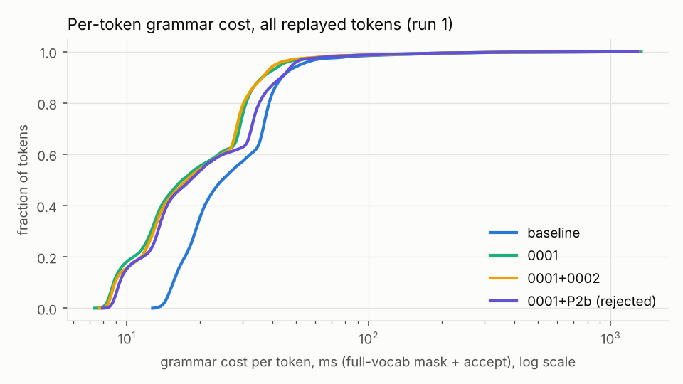
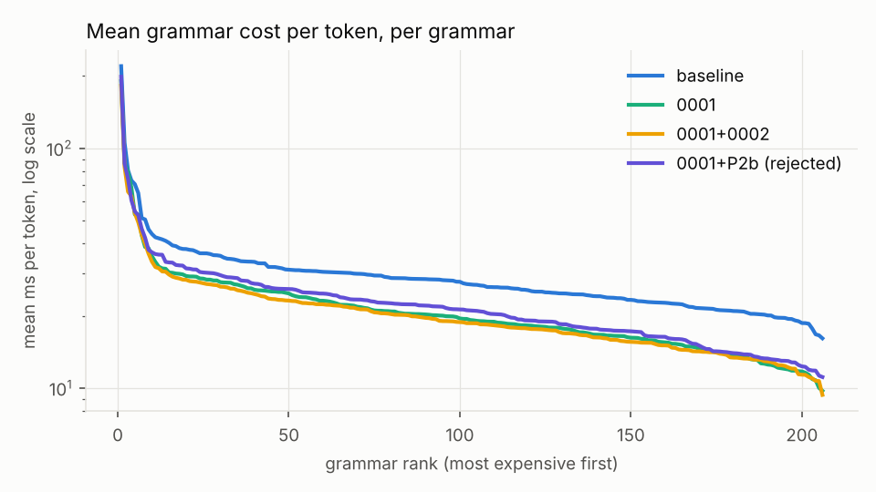
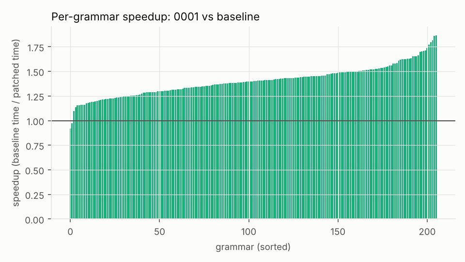
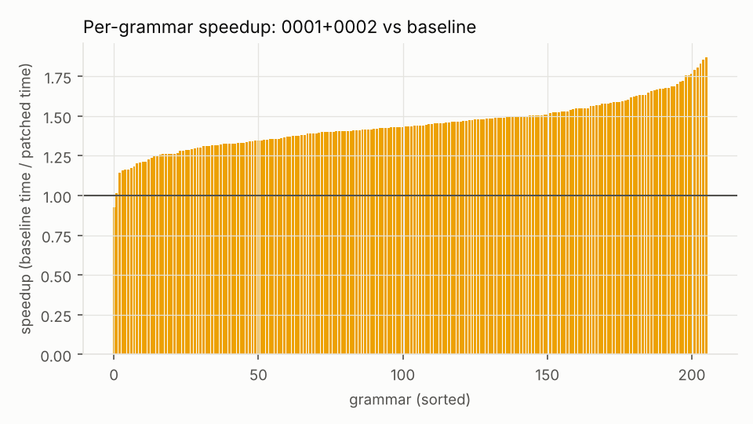
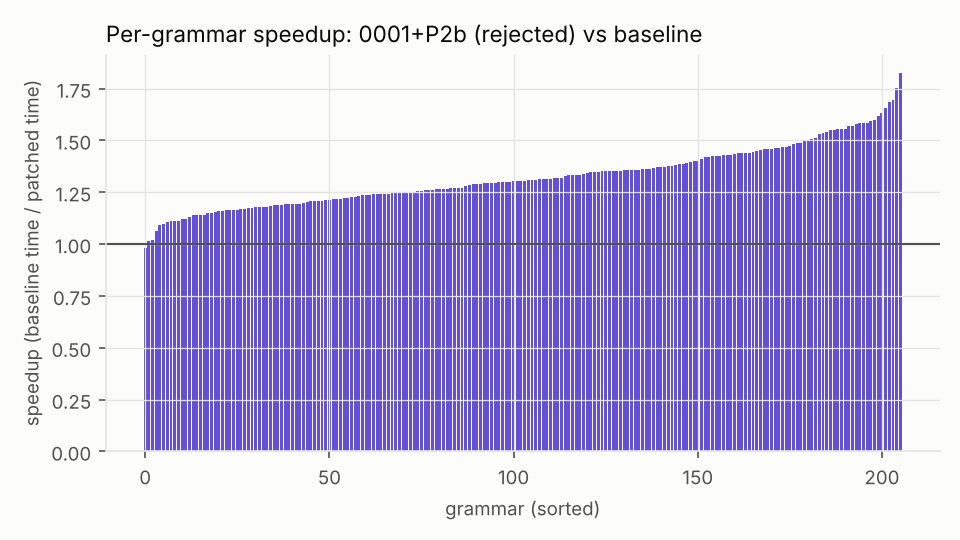
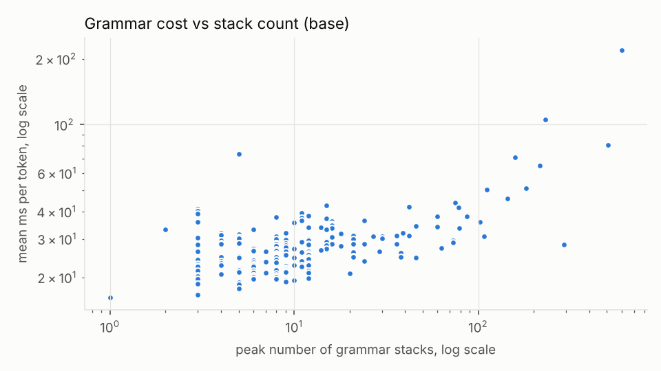

# Benchmark summary: `ab-v139`

```
date=2026-10-16T12:19:38+00:00 host=vm kernel=6.18.44-fc-v139 nproc=4 runs=3 jobs=1 model=qwen05 filter=
model name	: Intel(R) Xeon(R) Processor @ 2.80GHz
build build/bench-base: 620d2225cc436ab0b001e3200e590e3b286ef9ab 
build build/bench-p1: 620d2225cc436ab0b001e3200e590e3b286ef9ab  1 file changed, 34 insertions(+), 14 deletions(-)
build build/bench-p1ascii: 620d2225cc436ab0b001e3200e590e3b286ef9ab  1 file changed, 46 insertions(+), 16 deletions(-)
build build/bench-p2b: 620d2225cc436ab0b001e3200e590e3b286ef9ab  1 file changed, 88 insertions(+), 17 deletions(-)
MASKS IDENTICAL: base vs p1 (23448 steps)
MASKS IDENTICAL: base vs p1ascii (23448 steps)
MASKS IDENTICAL: base vs p2b (23448 steps)
```

Values: median over runs [min .. max over runs]. Times in microseconds per token (mask + accept) unless noted.

| build | runs | grammars | tokens | median of per-grammar mean | mean over all tokens | pooled p50 | pooled p99 | total replay (s) |
|---|---|---|---|---|---|---|---|---|
| base | 3 | 206 | 23448 | 27608.7 [25213.8 .. 27971.9] | 33496.9 [32335.6 .. 34854.5] | 25609.9 [24780.0 .. 26166.5] | 160520.4 [153051.4 .. 172551.3] | 785.43 [758.21 .. 817.27] |
| p1 | 3 | 206 | 23448 | 19530.3 [19016.2 .. 19914.2] | 25544.9 [24730.6 .. 26075.6] | 17735.0 [16952.5 .. 17873.1] | 138973.1 [134942.6 .. 142698.1] | 598.98 [579.88 .. 611.42] |
| p1ascii | 3 | 206 | 23448 | 18732.4 [18630.6 .. 18995.6] | 24462.7 [23970.0 .. 24757.9] | 17668.4 [16845.2 .. 17702.3] | 129275.1 [121499.4 .. 135649.3] | 573.60 [562.05 .. 580.52] |
| p2b | 3 | 206 | 23448 | 21173.5 [20201.4 .. 21918.2] | 26876.2 [25173.6 .. 26891.5] | 18050.3 [16199.9 .. 18300.6] | 126343.3 [117634.3 .. 128767.3] | 630.19 [590.27 .. 630.55] |

## Per subset (base)

| subset | grammars | median per-grammar mean (us) | median per-grammar p99 (us) | max peak stacks |
|---|---|---|---|---|
| Github_easy | 20 | 26278 | 49526 | 73 |
| Github_hard | 20 | 24599 | 54809 | 216 |
| Github_medium | 20 | 28219 | 54865 | 73 |
| Github_trivial | 20 | 25503 | 40006 | 30 |
| Github_ultra | 20 | 30828 | 62201 | 600 |
| Glaiveai2K | 20 | 22408 | 47141 | 12 |
| JsonSchemaStore | 18 | 30356 | 55618 | 505 |
| Kubernetes | 20 | 26272 | 44651 | 18 |
| Snowplow | 20 | 28473 | 55304 | 159 |
| WashingtonPost | 20 | 30916 | 53933 | 144 |
| gbnf | 8 | 30808 | 49238 | 12 |

## Worst 10 grammars by mean per-token cost (base)

| grammar | tokens | mean (us) | p50 (us) | p99 (us) | max (us) | peak stacks |
|---|---|---|---|---|---|---|
| jsb__Github_ultra__o46322 | 215 | 219648 | 28350 | 1242356 | 1425038 | 600 |
| jsb__JsonSchemaStore__rustfmt | 184 | 105342 | 24829 | 477258 | 538066 | 231 |
| jsb__JsonSchemaStore__mason-registry | 162 | 80801 | 27414 | 607804 | 745447 | 505 |
| gbnf__english | 113 | 73306 | 70716 | 107445 | 111266 | 5 |
| jsb__Snowplow__sp_408_Normalized | 254 | 70782 | 26739 | 332080 | 381152 | 159 |
| jsb__Github_hard__o6347 | 126 | 65000 | 36340 | 409586 | 489872 | 216 |
| jsb__Github_ultra__o17072 | 89 | 51128 | 23679 | 381429 | 387005 | 182 |
| jsb__JsonSchemaStore__project-1 | 256 | 50426 | 39423 | 200445 | 225434 | 111 |
| jsb__WashingtonPost__wp_17_Normalized | 256 | 45863 | 37574 | 290127 | 305936 | 144 |
| jsb__Github_hard__o36011 | 256 | 43850 | 42719 | 144932 | 179735 | 75 |

Median grammar by mean per-token cost: `gbnf__japanese`

## A/B ratios (other / base, run i vs run i; < 1 is faster)

| build | median of per-grammar mean | mean over all tokens | pooled p99 | total |
|---|---|---|---|---|
| p1 | 0.721 [0.698 .. 0.754] | 0.763 [0.748 .. 0.765] | 0.882 [0.805 .. 0.889] | 0.763 [0.748 .. 0.765] |
| p1ascii | 0.675 [0.670 .. 0.753] | 0.730 [0.688 .. 0.766] | 0.757 [0.749 .. 0.886] | 0.730 [0.688 .. 0.766] |
| p2b | 0.767 [0.722 .. 0.869] | 0.772 [0.752 .. 0.831] | 0.746 [0.733 .. 0.825] | 0.772 [0.752 .. 0.831] |

## Charts







