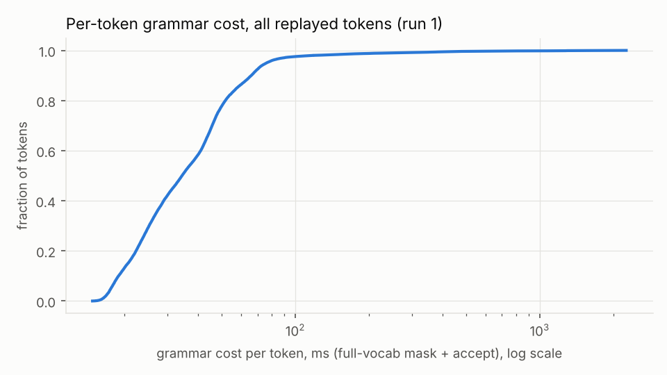
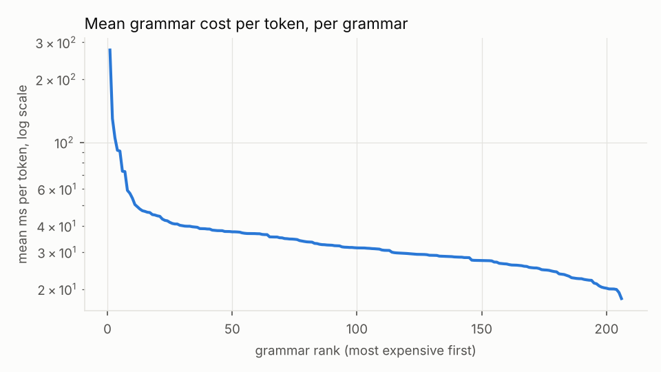
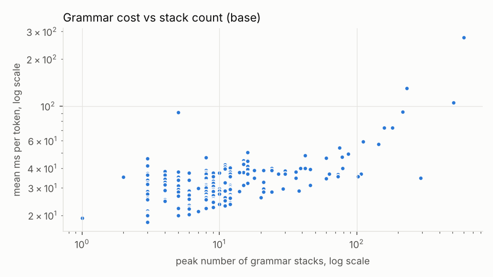

# Benchmark summary: `baseline-qwen05`

```
date=2026-10-15T16:04:51+00:00 host=vm nproc=4 runs=5 jobs=1 model=qwen05 filter=
model name	: Intel(R) Xeon(R) Processor @ 2.80GHz
build build/bench-base: 620d2225cc436ab0b001e3200e590e3b286ef9ab
```

Values: median over runs [min .. max over runs]. Times in microseconds per token (mask + accept) unless noted.

| build | runs | grammars | tokens | median of per-grammar mean | mean over all tokens | pooled p50 | pooled p99 | total replay (s) |
|---|---|---|---|---|---|---|---|---|
| base | 5 | 206 | 23448 | 31251.7 [28958.3 .. 34138.3] | 40322.9 [35474.6 .. 44785.1] | 31354.6 [27654.3 .. 34309.2] | 199032.8 [162795.5 .. 250991.6] | 945.49 [831.81 .. 1050.12] |

## Per subset (base)

| subset | grammars | median per-grammar mean (us) | median per-grammar p99 (us) | max peak stacks |
|---|---|---|---|---|
| Github_easy | 20 | 31749 | 61445 | 73 |
| Github_hard | 20 | 31115 | 70474 | 216 |
| Github_medium | 20 | 34793 | 71565 | 73 |
| Github_trivial | 20 | 31358 | 54236 | 30 |
| Github_ultra | 20 | 36829 | 75259 | 600 |
| Glaiveai2K | 20 | 24199 | 53721 | 12 |
| JsonSchemaStore | 18 | 37962 | 69199 | 505 |
| Kubernetes | 20 | 29112 | 51923 | 18 |
| Snowplow | 20 | 30147 | 61110 | 159 |
| WashingtonPost | 20 | 32631 | 58687 | 144 |
| gbnf | 8 | 34330 | 54310 | 12 |

## Worst 10 grammars by mean per-token cost (base)

| grammar | tokens | mean (us) | p50 (us) | p99 (us) | max (us) | peak stacks |
|---|---|---|---|---|---|---|
| jsb__Github_ultra__o46322 | 215 | 275651 | 31945 | 1525128 | 1642988 | 600 |
| jsb__JsonSchemaStore__rustfmt | 184 | 129808 | 29139 | 587917 | 705675 | 231 |
| jsb__JsonSchemaStore__mason-registry | 162 | 105195 | 33120 | 934152 | 1063581 | 505 |
| jsb__Github_hard__o6347 | 126 | 91674 | 55269 | 657743 | 733897 | 216 |
| gbnf__english | 113 | 90947 | 86772 | 134735 | 139327 | 5 |
| jsb__Snowplow__sp_408_Normalized | 254 | 72849 | 27294 | 338499 | 377588 | 159 |
| jsb__Github_ultra__o17072 | 89 | 72619 | 36112 | 466727 | 474930 | 182 |
| jsb__JsonSchemaStore__project-1 | 256 | 59087 | 42216 | 249208 | 298356 | 111 |
| jsb__WashingtonPost__wp_17_Normalized | 256 | 57178 | 40455 | 335538 | 429516 | 144 |
| jsb__Github_hard__o36011 | 256 | 54242 | 47114 | 210847 | 241643 | 75 |

Median grammar by mean per-token cost: `jsb__Github_trivial__o45114`

## Charts




