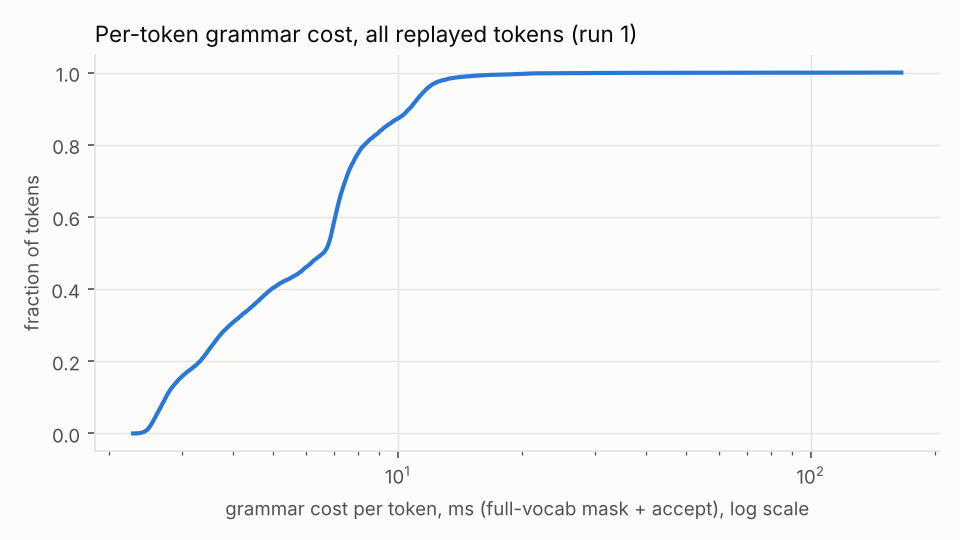
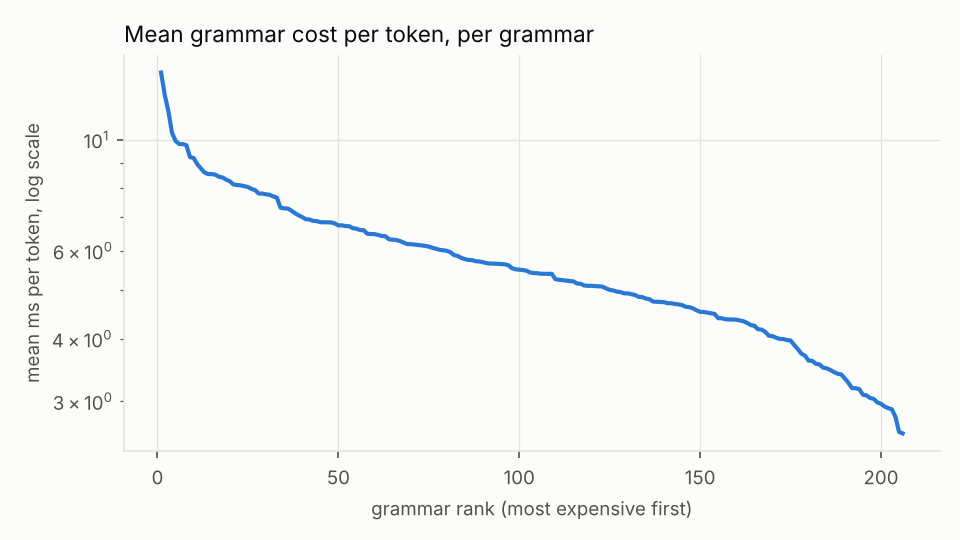
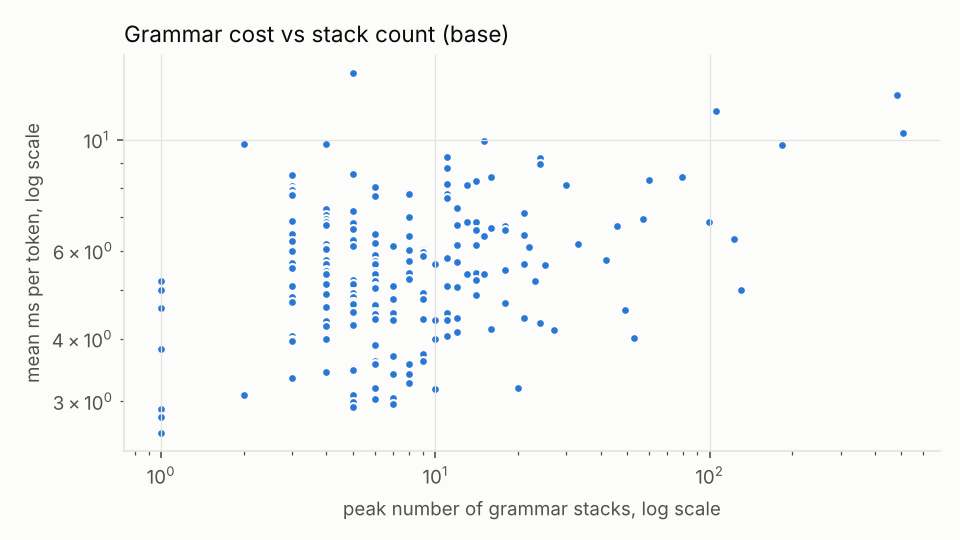

# Benchmark summary: `baseline-tinyllama`

```
date=2026-10-15T18:30:04+00:00 host=vm nproc=4 runs=3 jobs=1 model=tinyllama filter=
model name	: Intel(R) Xeon(R) Processor @ 2.80GHz
build build/bench-base: 620d2225cc436ab0b001e3200e590e3b286ef9ab
```

Values: median over runs [min .. max over runs]. Times in microseconds per token (mask + accept) unless noted.

| build | runs | grammars | tokens | median of per-grammar mean | mean over all tokens | pooled p50 | pooled p99 | total replay (s) |
|---|---|---|---|---|---|---|---|---|
| base | 3 | 206 | 21202 | 5543.8 [5232.1 .. 5676.1] | 6377.6 [6125.9 .. 6576.9] | 6606.4 [6382.6 .. 6618.4] | 14887.8 [14863.2 .. 15033.9] | 135.22 [129.88 .. 139.44] |

## Per subset (base)

| subset | grammars | median per-grammar mean (us) | median per-grammar p99 (us) | max peak stacks |
|---|---|---|---|---|
| Github_easy | 20 | 5874 | 10334 | 12 |
| Github_hard | 20 | 5153 | 11102 | 33 |
| Github_medium | 20 | 5252 | 11257 | 24 |
| Github_trivial | 20 | 4630 | 6358 | 16 |
| Github_ultra | 20 | 5801 | 11206 | 480 |
| Glaiveai2K | 20 | 4511 | 8566 | 12 |
| JsonSchemaStore | 18 | 6507 | 11611 | 505 |
| Kubernetes | 20 | 6166 | 11615 | 23 |
| Snowplow | 20 | 5438 | 10549 | 79 |
| WashingtonPost | 20 | 6085 | 11280 | 60 |
| gbnf | 8 | 6470 | 11332 | 12 |

## Worst 10 grammars by mean per-token cost (base)

| grammar | tokens | mean (us) | p50 (us) | p99 (us) | max (us) | peak stacks |
|---|---|---|---|---|---|---|
| gbnf__english | 256 | 13626 | 11967 | 21168 | 27239 | 5 |
| jsb__Github_ultra__o46322 | 82 | 12304 | 4374 | 126032 | 146510 | 480 |
| jsb__JsonSchemaStore__project-1 | 47 | 11419 | 9674 | 44543 | 45050 | 105 |
| jsb__JsonSchemaStore__mason-registry | 256 | 10339 | 7448 | 140956 | 195505 | 505 |
| jsb__JsonSchemaStore__zapp-schema-1 | 256 | 9946 | 9932 | 13904 | 18039 | 15 |
| jsb__Kubernetes__kb_455_Normalized | 47 | 9806 | 11412 | 13637 | 13757 | 4 |
| gbnf__list | 256 | 9803 | 8653 | 14359 | 15095 | 2 |
| jsb__JsonSchemaStore__rustfmt | 84 | 9750 | 5116 | 75722 | 78076 | 183 |
| jsb__WashingtonPost__wp_95_Normalized | 32 | 9233 | 9676 | 11781 | 11817 | 11 |
| jsb__Snowplow__sp_189_Normalized | 256 | 9194 | 8859 | 13805 | 16039 | 24 |

Median grammar by mean per-token cost: `jsb__Github_medium__o5344`

## Charts




